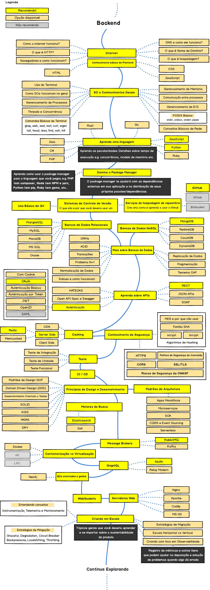

  
  <h1 align="center">Guia de Back-end</h1>

## :dart: O guia para alavancar a sua carreira

> Back-end é a camada que sustenta qualquer aplicação: APIs, bancos de dados, autenticação, filas, arquitetura e tudo o que roda no servidor sem o usuário ver diretamente. Este guia reúne roadmap, cursos gratuitos e pagos, documentação oficial de linguagens e frameworks, bancos de dados, ferramentas, arquitetura e boas práticas, comunidades e um capítulo dedicado a usar IA na prática no dia a dia de back-end — tudo verificado e organizado para quem está começando ou já atua na área e quer se manter atualizado.

 <strong>Segue nas redes sociais para acompanhar mais conteúdo: </strong>  

## ⚠️ Aviso importante

> Antes de tudo você pode me ajudar e colaborar, deu bastante trabalho fazer esse repositório e organizar para fazer seu estudo ou trabalho melhor, portanto você pode me ajudar das seguintes maneiras:

- Me siga no [Github](https://github.com/arthurspk)
- Acesse as redes sociais do [Guia Dev Brasil](https://linktr.ee/guiadevbrasil)
- Mande feedbacks no [LinkedIn](https://www.linkedin.com/in/arthurspk/)

## 💡 Nossa proposta

> A proposta deste guia é dar uma ideia sobre o atual panorama e guiá-lo se você estiver confuso sobre qual será o seu próximo aprendizado, sem influenciar você a seguir os 'hypes' e 'trends' do momento. Acreditamos que com um maior conhecimento das diferentes estruturas e soluções disponíveis poderá escolher a ferramenta que melhor se aplica às suas demandas. E lembre-se, 'hypes' e 'trends' nem sempre são as melhores opções.

## :beginner: Para quem está começando agora

> Não se assuste com a quantidade de conteúdo apresentado neste guia. Acredito que quem está começando pode usá-lo não como um objetivo, mas como um apoio para os estudos. <b>Neste momento, dê enfoque no que te dá produtividade e o restante marque como <i>Ver depois</i></b>. Ao passo que seu conhecimento se torna mais amplo, a tendência é este guia fazer mais sentido e ficar fácil de ser assimilado. Bons estudos e entre em contato sempre que quiser! :punch:

## 🚨 Colabore

- Abra Pull Requests com atualizações
- Discuta ideias em Issues
- Compartilhe o repositório com a sua comunidade

## 🌍 Tradução

> Se você deseja acompanhar esse repositório em outro idioma que não seja o Português Brasileiro, você pode optar pelas escolhas de idiomas abaixo, você também pode colaborar com a tradução para outros idiomas e a correções de possíveis erros ortográficos, a comunidade agradece.

・<b>English — </b> [Click Here](https://github.com/arthurspk/guiadobackend) 
・<b>Spanish — </b> [Click Here](https://github.com/arthurspk/guiadobackend) 
・<b>Chinese — </b> [Click Here](https://github.com/arthurspk/guiadobackend) 
・<b>Hindi — </b> [Click Here](https://github.com/arthurspk/guiadobackend) 
・<b>Arabic — </b> [Click Here](https://github.com/arthurspk/guiadobackend) 
・<b>French — </b> [Click Here](https://github.com/arthurspk/guiadobackend) 
・<b>Italian — </b> [Click Here](https://github.com/arthurspk/guiadobackend) 
・<b>Korean — </b> [Click Here](https://github.com/arthurspk/guiadobackend) 
・<b>Russian — </b> [Click Here](https://github.com/arthurspk/guiadobackend) 
・<b>German — </b> [Click Here](https://github.com/arthurspk/guiadobackend) 
・<b>Japanese — </b> [Click Here](https://github.com/arthurspk/guiadobackend) 

## 📚 ÍNDICE

[🗺️ Roadmap](#️-roadmap)  
[🚀 Por onde começar](#-por-onde-começar)  
[🎓 Cursos gratuitos](#-cursos-gratuitos)  
[💰 Cursos pagos](#-cursos-pagos)  
[📖 Documentação oficial](#-documentação-oficial)  
[💻 Linguagens e frameworks para Back-end](#-linguagens-e-frameworks-para-back-end)  
[🗄️ Bancos de dados](#️-bancos-de-dados)  
[☁️ Cloud, containers e infraestrutura](#️-cloud-containers-e-infraestrutura)  
[🏗️ Arquitetura e boas práticas](#️-arquitetura-e-boas-práticas)  
[📚 Livros](#-livros)  
[🎥 Canais no Youtube](#-canais-no-youtube)  
[📰 Sites, blogs e newsletters](#-sites-blogs-e-newsletters)  
[🛠️ Ferramentas](#️-ferramentas)  
[🧪 Projetos práticos e desafios](#-projetos-práticos-e-desafios)  
[🤖 IA na prática](#-ia-na-prática)  
[🎓 Certificações](#-certificações)  
[💼 Carreira e vagas](#-carreira-e-vagas)  
[👥 Comunidades](#-comunidades)  

## 🗺️ Roadmap

- [roadmap.sh — Backend Roadmap](https://roadmap.sh/backend) — Roadmap visual e interativo da comunidade: linguagens, bancos de dados, APIs, cache, mensageria e arquitetura, com links por tópico.
- [roadmap.sh — API Design](https://roadmap.sh/api-design) — Roadmap específico para projetar APIs REST, GraphQL e gRPC do zero.

## 🚀 Por onde começar

1. **Linux e terminal** — [Guia Foca](https://guiafoca.org/) explica desde o básico de um sistema GNU/Linux até administração e segurança, em português.
2. **Git e GitHub** — [Git4Noobs](https://github.com/DanielHe4rt/git4noobs) ensina o essencial sem assustar; pratique visualmente no [Learn Git Branching](https://learngitbranching.js.org/?locale=pt_BR) e no [Git School](https://git-school.github.io/visualizing-git/).
3. **HTTP** — [MDN — HTTP](https://developer.mozilla.org/pt-BR/docs/Web/HTTP) explica o protocolo que sustenta toda comunicação cliente-servidor.
4. **APIs** — leia [O que é uma API REST? (Red Hat)](https://www.redhat.com/pt-br/topics/api/what-is-a-rest-api) e depois pratique consumindo dados reais na lista [APIs Públicas](https://github.com/public-apis/public-apis).
5. **Escolha uma linguagem e um banco de dados** — veja as seções [💻 Linguagens e frameworks](#-linguagens-e-frameworks-para-back-end) e [🗄️ Bancos de dados](#️-bancos-de-dados) abaixo para comparar as opções mais usadas no mercado.
6. **Construa sua primeira API** e publique o código no GitHub — isso já vale mais que qualquer certificado no início de carreira.

## 🎓 Cursos gratuitos

- [Back End Development and APIs — freeCodeCamp (em português)](https://www.freecodecamp.org/portuguese/learn/back-end-development-and-apis/) — currículo gratuito e completo, com certificado ao final.
- [DIO — Digital Innovation One](https://www.dio.me/) — cursos e trilhas gratuitas com certificado, incluindo back-end, bancos de dados e cloud.
- [Formação Node.js — módulo introdutório (Rocketseat)](https://www.rocketseat.com.br/formacao/node) — primeiros módulos gratuitos; a formação completa é paga.
- [Intensivão Nest.js: do Básico ao Avançado (Full Cycle)](https://www.youtube.com/watch?v=PHIMN85trgk) — aula gratuita e completa sobre o framework Nest.js, para quem já sabe Node.js.
- [balta.io](https://balta.io/) — cursos gratuitos de C#, .NET e back-end em geral; parte do catálogo é paga (balta PRO).
- [Cursos de Git & GitHub — repositório geral do Guia Dev Brasil](https://github.com/arthurspk/guiadevbrasil#-cursos-de-git-e-github) — trilha de Git e GitHub do guia-mãe da rede.

## 💰 Cursos pagos

- [Desenvolvimento Back-end com Node.js — trilha de carreira (Alura)](https://www.alura.com.br/carreiras/desenvolvimento-backend-nodejs) — formação completa em português, do básico a sistemas com boas práticas.
- [Formação Node.js completa (Rocketseat)](https://www.rocketseat.com.br/formacao/node) — APIs, bancos de dados e sistemas escaláveis com Node.js e TypeScript.
- [balta PRO](https://balta.io/) — assinatura com trilhas avançadas de C#, .NET e arquitetura de sistemas.

## 📖 Documentação oficial

- [JSON:API — especificação](https://jsonapi.org/) — formato padronizado para construir APIs em JSON.
- [OpenAPI / Swagger — documentação](https://swagger.io/docs/) — especificação e ferramentas para documentar APIs REST.
- [GraphQL — documentação oficial](https://graphql.org/learn/) — linguagem de consulta alternativa ao REST, mantida pela GraphQL Foundation.
- [gRPC — documentação oficial](https://grpc.io/docs/) — framework de RPC de alta performance usado em comunicação entre microsserviços.

## 💻 Linguagens e frameworks para Back-end

> Documentação oficial das linguagens e frameworks mais usados para back-end. [W3Schools](https://www.w3schools.com/) tem referência rápida, exemplos e editor online para praticamente todas elas.

- **Node.js** — [Documentação oficial](https://nodejs.org/en/docs/) · framework [NestJS](https://docs.nestjs.com/) ([o que é o Nestjs — TreinaWeb](https://www.treinaweb.com.br/blog/o-que-e-nestjs)).
- **Python** — [Documentação oficial em PT-BR](https://docs.python.org/pt-br/3/tutorial/) · framework [Django](https://docs.djangoproject.com/en/5.1/).
- **Java** — [Documentação oficial (Java SE 21)](https://docs.oracle.com/en/java/javase/21/docs/api/index.html) · framework [Spring Boot](https://spring.io/projects/spring-boot).
- **C#** — [Documentação oficial em PT-BR](https://learn.microsoft.com/pt-br/dotnet/csharp/) · framework [ASP.NET Core](https://learn.microsoft.com/pt-br/aspnet/core/?view=aspnetcore-8.0).
- **Go** — [Documentação oficial](https://go.dev/doc/) — linguagem da Google, muito usada em back-ends de alta performance e ferramentas de infraestrutura.
- **PHP** — [Documentação oficial em PT-BR](https://www.php.net/manual/pt_BR/index.php) — ainda roda boa parte da web, incluindo WordPress e Laravel.
- **Ruby** — [Documentação oficial em PT-BR](https://www.ruby-lang.org/pt/documentation/) — base do framework Ruby on Rails.
- **Kotlin** — [Documentação oficial](https://kotlinlang.org/docs/home.html) — alternativa moderna ao Java na JVM, também usada em back-end.
- **C / C++** — [Documentação da linguagem C (Microsoft Learn)](https://learn.microsoft.com/pt-br/cpp/c-language/?view=msvc-170) · [Documentação da linguagem C++ (Microsoft Learn)](https://learn.microsoft.com/pt-br/cpp/cpp/?view=msvc-170) — usadas em sistemas de baixo nível e serviços de alta performance.
- **TypeScript** — [Documentação oficial](https://www.typescriptlang.org/docs/) — cada vez mais comum em back-ends Node.js pela tipagem estática.

## 🗄️ Bancos de dados

- [PostgreSQL — Documentação oficial](https://www.postgresql.org/docs/) e [Tutorial oficial](https://www.postgresql.org/docs/current/tutorial.html) — banco relacional open source mais usado em projetos back-end modernos.
- [MySQL — Documentação oficial (Oracle Help Center)](https://docs.oracle.com/cd/E17952_01/mysql-8.4-en/) — espelho oficial da documentação do MySQL 8.4 LTS.
- [MongoDB — Documentação oficial](https://www.mongodb.com/docs/) — banco NoSQL orientado a documentos, muito usado com Node.js.
- [SQL — W3Schools](https://www.w3schools.com/sql/default.asp) — referência com editor SQL interativo para praticar consultas.
- [SQL Server — Documentação oficial em PT-BR](https://learn.microsoft.com/pt-br/sql/?view=sql-server-ver16) — banco relacional da Microsoft, comum em ambientes corporativos.

## ☁️ Cloud, containers e infraestrutura

- [Docker — Documentação oficial](https://docs.docker.com/) e [Guia de introdução](https://docs.docker.com/get-started/) — containers são hoje o padrão para empacotar e implantar back-ends.
- [Docker 101 Tutorial](https://www.docker.com/101-tutorial/) — tutorial prático: criar imagens, rodar contêineres e usar Docker Compose.
- [AWS — Documentação oficial](https://docs.aws.amazon.com/) — a nuvem mais usada no mercado brasileiro para hospedar back-ends.
- [DigitalOcean Community Tutorials](https://www.digitalocean.com/community/tutorials) — tutoriais gratuitos e muito diretos sobre deploy, servidores e infraestrutura.

## 🏗️ Arquitetura e boas práticas

- [The Twelve-Factor App (em português)](https://12factor.net/pt_br/) — metodologia clássica com 12 práticas para construir aplicações back-end escaláveis e fáceis de manter.
- [Refactoring Guru — Padrões de projeto (PT-BR)](https://refactoring.guru/pt-br/design-patterns) — catálogo ilustrado dos principais design patterns.
- [Quais são os tipos de arquitetura de software (PUC-PR)](https://posdigital.pucpr.br/blog/tipos-de-arquitetura-de-software) — panorama de monolito, microsserviços, serverless e mais.
- [microservices.io](https://microservices.io/) — catálogo de padrões para projetar e operar microsserviços, mantido por Chris Richardson.
- [Martin Fowler — artigos de arquitetura](https://martinfowler.com/architecture/) — referência histórica em arquitetura de software, DDD e refatoração.

## 📚 Livros

- [Código Limpo — Robert C. Martin](https://www.amazon.com.br/C%C3%B3digo-limpo-Robert-C-Martin/dp/8576082675) — princípios e práticas para escrever código legível e fácil de manter.
- [Arquitetura Limpa — Robert C. Martin](https://www.amazon.com.br/Arquitetura-Limpa-Artes%C3%A3o-Estrutura-Software/dp/8550804606) — como organizar sistemas em camadas independentes de framework e banco de dados.
- [Refatoração — Martin Fowler](https://www.amazon.com.br/Refatora%C3%A7%C3%A3o-Aperfei%C3%A7oando-design-c%C3%B3digos-existentes-ebook/dp/B087N8LKYB) — como melhorar a estrutura de um código já existente sem quebrar seu comportamento.
- [O Programador Pragmático — Andrew Hunt e David Thomas](https://www.amazon.com.br/Programador-Pragm%C3%A1tico-Aprendiz-Mestre/dp/8577807002) — hábitos e práticas para evoluir de programador iniciante a experiente.
- [Designing Data-Intensive Applications — Martin Kleppmann](https://dataintensive.net/) — site oficial do livro (em inglês): referência sobre bancos de dados, replicação e sistemas distribuídos em escala.

## 🎥 Canais no Youtube

- [Full Cycle](https://www.youtube.com/@FullCycle) — arquitetura, microsserviços, Docker e boas práticas de back-end em profundidade.
- [Código Fonte TV](https://www.youtube.com/codigofontetv) — conteúdo descontraído sobre desenvolvimento em geral, incluindo back-end.
- [Rocketseat](https://www.youtube.com/@rocketseat) — lives e aulas gratuitas sobre Node.js, APIs e back-end.
- [Programador BR](https://www.youtube.com/@programadorbr) — carreira e tecnologia para desenvolvedores brasileiros.

## 📰 Sites, blogs e newsletters

- [TabNews](https://www.tabnews.com.br/) — comunidade e newsletter diária de notícias e discussões técnicas, criada por Filipe Deschamps.
- [Node Weekly](https://nodeweekly.com/) — newsletter semanal (em inglês) com as principais novidades do ecossistema Node.js.
- [BrazilJS Weekly](https://github.com/braziljs/weekly) — seleção semanal de novidades sobre desenvolvimento web no Brasil e no mundo.
- [Martin Fowler](https://martinfowler.com/) — blog de referência sobre arquitetura, refatoração e práticas ágeis.
- [Macoratti.net](https://www.macoratti.net/) — tutoriais em português sobre C#, ASP.NET e bancos de dados, ativo desde os anos 2000.
- [Alura — artigos de back-end](https://www.alura.com.br/artigos/backend) — artigos gratuitos sobre APIs, bancos de dados e arquitetura.

## 🛠️ Ferramentas

- [Postman](https://www.postman.com/) — cliente de API mais usado do mercado, com coleções, testes automatizados e mocks.
- [Insomnia](https://insomnia.rest/) — cliente de API open source com interface enxuta e suporte nativo a GraphQL.
- [Bruno](https://www.usebruno.com/) — cliente de API open source que guarda as coleções em arquivos de texto versionáveis no Git, sem depender de conta na nuvem.
- [APIs Públicas](https://github.com/public-apis/public-apis) — lista para consumir dados reais em projetos de estudo.

## 🧪 Projetos práticos e desafios

- [Dev Challenge Back-End](https://devchallenge.vercel.app/challenges?type=backend) — desafios com filtro específico para back-end.
- [HackerRank](https://www.hackerrank.com/) — desafios de programação com IDE integrada.
- [CodeWars](https://www.codewars.com/) — desafios (katas) de programação com IDE integrada.
- [CoderByte](https://coderbyte.com/) — desafios de programação com IDE integrada.
- [CodinGame](https://www.codingame.com/start) — desafios de programação com temática de jogos, IDE integrada.
- [Edabit](https://edabit.com/) — desafios de programação com IDE integrada.
- [ChallengeRocket](https://challengerocket.com/) — desafios de programação com IDE integrada.
- [CodeSignal](https://app.codesignal.com/login) — desafios de programação, também usado em processos seletivos técnicos.
- [Codility](https://www.codility.com/) — desafios de programação com IDE integrada.
- [CSES Problem Set](https://cses.fi/problemset/) — desafios de programação com IDE integrada.
- [DailyCodingProblem](https://www.dailycodingproblem.com/) — desafios de programação enviados por e-mail.
- [CodeAbbey](https://www.codeabbey.com/) — desafios de programação com IDE integrada.
- [ProjectEuler](https://projecteuler.net/) — desafios de programação focados em problemas matemáticos.
- [TopCoder](https://www.topcoder.com/) — desafios e arena de programação competitiva.

## 🤖 IA na prática

Back-end é uma das áreas onde IA generativa mais economiza tempo: código repetitivo (CRUD, migrations, testes) sobra, e os erros de um back-end mal revisado são caros (SQL injection, vazamento de dados, endpoint sem autenticação). Use a IA a favor da produtividade sem abrir mão da revisão.

**Para aprender**
- Peça para uma IA **explicar um erro de banco de dados ou stack trace** linha a linha e sugerir a causa mais provável, não só "a solução".
- Cole o `schema` de um banco e peça para gerar **consultas SQL comentadas** explicando cada cláusula (`JOIN`, `GROUP BY`, índices).
- Peça para **gerar uma API REST de exemplo** (rotas, controllers, validação) em uma linguagem que você está aprendendo, e depois pergunte "por que essa estrutura de pastas?".
- Peça **exercícios com gabarito** sobre o tópico que está estudando (autenticação, filas, cache, testes).

**Para trabalhar**
- Use [GitHub Copilot](https://docs.github.com/copilot), [Cursor](https://cursor.com/) ou [Sourcegraph Cody](https://sourcegraph.com/cody) para gerar testes unitários, migrations de banco de dados, documentação de endpoints (OpenAPI/Swagger) e refatorações mecânicas.
- Use assistentes de IA no console da nuvem, como o [Amazon Q Developer](https://aws.amazon.com/q/developer/), para gerar e explicar comandos de infraestrutura (IaC).
- Depois de **cada** sugestão aceita, rode a suíte de testes e o linter. Nunca aplique uma migration de banco gerada por IA direto em produção sem revisar.

**Limites e boas práticas**
- IA **inventa nomes de pacotes, métodos e parâmetros de API** que não existem (alucinação). Confirme sempre na documentação oficial antes de instalar uma dependência sugerida.
- Nunca cole segredos, tokens, strings de conexão de banco ou dados de clientes em ferramentas de IA sem a política de segurança da sua empresa.
- Revise manualmente qualquer código de autenticação, autorização ou manipulação de dados sensíveis gerado por IA — é a parte do back-end onde um erro sai mais caro.
- Entenda o que você aceita: em entrevista técnica e em produção, o código é seu, não da IA.

## 🎓 Certificações

- [AWS Certified Developer — Associate](https://aws.amazon.com/pt/certification/certified-developer-associate/) — certificação paga da AWS focada em desenvolvimento e integração com serviços de nuvem.
- [Google Cloud — Professional Cloud Developer](https://cloud.google.com/certification/cloud-developer) — certificação paga do Google Cloud para desenvolvimento de aplicações em nuvem.
- [Microsoft Certified: Azure Developer Associate](https://learn.microsoft.com/pt-br/certifications/azure-developer/) — certificação paga da Microsoft para desenvolvimento de soluções na Azure.
- [DIO — certificados gratuitos de conclusão de curso](https://www.dio.me/) — bom primeiro certificado para currículo, mas não substitui portfólio.

## 💼 Carreira e vagas

- [ProgramaThor — vagas remotas de back-end](https://programathor.com.br/jobs-api/remoto) — vagas brasileiras filtráveis por tecnologia (API, Java, Python, Go e outras).
- [vagas.dev](https://vagas.dev/) — vagas de tecnologia agregadas de diversas fontes, com filtro por stack.
- [Remotar](https://remotar.com.br/) — vagas 100% remotas para desenvolvedores brasileiros.
- [backend-br/vagas](https://github.com/backend-br/vagas) — vagas de back-end publicadas como issues no GitHub.
- [Coodesh](https://coodesh.com/) — vagas tech no Brasil com processos seletivos padronizados.
- [GeekHunter](https://www.geekhunter.com.br/) — plataforma brasileira onde empresas fazem propostas a desenvolvedores.

## 👥 Comunidades

- [Desenvolvedores Brasil (Discord)](https://discord.com/invite/t3vYGUuK6P) — comunidade brasileira com dicas, cursos, mentorias e vagas.
- [He4rt Developers](https://heartdevs.com/) — comunidade brasileira open source com Discord ativo e projetos de back-end.
- [DEV Community — devs brasileiros](https://dev.to/t/braziliandevs) — tag com artigos em português da comunidade brasileira.
- [r/backend](https://www.reddit.com/r/backend/) — subreddit dedicado a discussões de back-end.
- [Lista de grupos de tecnologia no Telegram (TI-Brasil)](https://github.com/TI-Brasil/lista-telegram-brasil) — diretório de grupos brasileiros no Telegram, incluindo back-end e infraestrutura.
